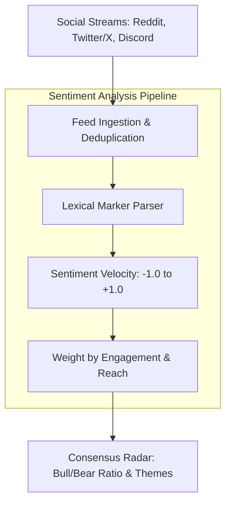

# social-sentiment-radar

[](https://github.com/elvalenciano1572-create/social-sentiment-radar/actions/workflows/ci.yml)


A high-performance Python engine for real-time sentiment analysis, crowd conviction scoring, and lexical trend detection across Twitter/X, Reddit, and investor forums.

Market prices are heavily driven by narrative velocity and retail chatter. **social-sentiment-radar** continuously scans unstructured social feeds, computes net sentiment indexes (-1.0 to +1.0), isolates dominant themes, and detects extreme sentiment divergences before quarterly earnings or product launches.

## Architecture



## Features

- **Multi-Platform Support**: Ingests posts from Twitter/X, Reddit, Discord, and online forums with unified schema contracts.
- **Engagement-Weighted Scoring**: High-engagement posts (upvotes, retweets) carry proportional influence on the net sentiment index.
- **Lexical Pattern Extraction**: Automatically extracts dominant bull keywords (*breakout, beat, moat*) and bear signals (*dump, guidance miss, multiple compression*).
- **Fast & Pure Python**: Zero bloated dependencies; runs lightweight in any background cron or container.

## Quick Start

```bash
git clone https://github.com/elvalenciano1572-create/social-sentiment-radar
cd social-sentiment-radar
python -m venv .venv && source .venv/bin/activate  # Windows: .venv\Scripts\activate
pip install -e ".[dev]"
pytest
sentiment-radar NVDA
```

## Example Output

```text
====================================================================
   SOCIAL SENTIMENT RADAR: REAL-TIME CONVERSATION ANALYTICS
====================================================================
[*] Ingested 5 social posts across Twitter/X, Reddit, & Forums.
[*] Analyzing sentiment velocity and lexical markers for: [NVDA]...

--- RADAR SYNTHESIS REPORT ---
Target Symbol:        NVDA
Consensus Verdict:    [BULLISH / POSITIVE]
Net Sentiment Index:  +0.20 (scale -1.0 to +1.0)
Viral Reach / Likes:  3,315 engagements

Distribution Breakdown:
  + Bullish: 60.0%
  - Bearish: 40.0%
  = Neutral: 0.0%

Dominant Bullish Keywords:
  accumulate, breakout, call, earnings beat, growth, long, profit, solid
Dominant Bearish Keywords:
  downside, dump, overvalued, puts, sell
====================================================================
```

## License

MIT

## Scope / Status

This repository is a **working demo on deterministic sample data** (runs offline, covered by automated tests). Uses a mock social feed and a keyword lexicon. Live Twitter/X or Reddit connectors are not implemented yet. Entries in `.env.example` are placeholders for those future connectors.
